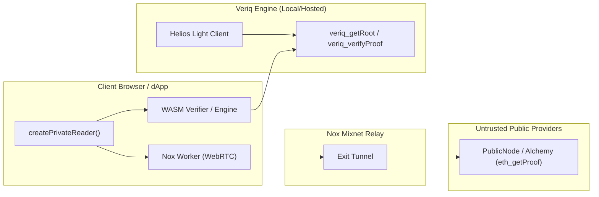

# Veriq & Anon-RPC: Master Architecture and Complete Build Plan

> **Specification & Delivery Roadmap**  
> *Consolidated from `ANON_RPC_BUILD_PLAN.md`, `docs/ANON_RPC_FEASIBILITY.md`, `future.md`, and the Veriq codebase.*

---

## 1. Executive Summary & Architectural Foundation

### 1.1 The Core Mission
**Veriq** is a trust-minimized Ethereum read engine designed to read state from untrusted JSON-RPC providers and cryptographically prove every answer.

- **The Problem:** dApps, wallets, and indexers blindly trust centralized RPC nodes (Alchemy, Infura, QuickNode, PublicNode) for state reads (`eth_getBalance`, `eth_getStorageAt`, `eth_getCode`, `eth_getTransactionCount`). If an RPC node lies, experiences an eclipse attack, or suffers a split-view reorg, clients accept forged balances or stale data. Furthermore, querying RPCs exposes user IP addresses and monitored wallet addresses.
- **The Engine Solution:** Veriq runs an embedded [Helios](https://github.com/a16z/helios) light client tracking Sepolia consensus headers from a pinned weak-subjectivity beacon checkpoint. It fetches Merkle-Patricia proofs (`eth_getProof`, EIP-1186) pinned to finalized block hashes (EIP-1898) and validates them locally. Untrusted providers never supply the state root.
- **The Anon-RPC Extension:** Anon-RPC introduces zero-trust, anonymous reads. By coupling the **Nox mixnet/WebRTC privacy network**, an **in-browser WebAssembly Merkle verifier**, and an **in-browser Helios light client**, dApps can execute private reads where no provider ever observes the user's IP or queried address, while retaining light-client verification.

---

## 2. Feasibility Gate Results (M0 & S4 Status)

All initial feasibility probes have been completed and verified on Sepolia:

| Probe | Objective | Status | Key Finding & Architectural Impact |
|---|---|---|---|
| **M0.0** | Test page & WebRTC harness | **PASS** (2026-11-05) | `@anon-rpc/browser-harness` 0.4.0 loads via native browser import maps (7 entries) without bundler overhead. Worker reaches ready in 6–8s. |
| **M0.1** | Nox to Beacon API (Consensus) | **FAIL $\to$ PASS** (2026-11-06) | Nimbus failed due to a private Cloudflare Origin CA certificate. Re-run on **ChainSafe Lodestar Sepolia succeeded** over Let's Encrypt. Discovered that Lodestar only retains witnesses for the *current* finalized epoch; browser Helios must bootstrap dynamically via **checkpointz** (`ethpandaops`) rather than a static pinned checkpoint. |
| **M0.2** | Public RPC (`eth_getProof`) via Nox | **PASS** (2026-11-05) | PublicNode load balances across backends with differing proof windows, causing intermittent `-32602` errors. Architectural requirement: SDK must retry across `finalized` tag, `{blockHash}` (EIP-1898), and hex block number. |
| **M0.3** | HTTP gzip compression over Nox | **PASS** (2026-11-05) | Nox forwards `Accept-Encoding: gzip`, and the browser transparently decompresses bodies before JavaScript execution. High burst traffic hits a finite exit tunnel pool (`NoTunnelExitError`), requiring backoff and connection budgeting. |
| **M0.4** | Rust verifier in WebAssembly | **PASS** (2026-11-05) | `veriq-verifier-wasm` compiles to a dependency-free **198 KiB** binary. Instantiates in 5 ms, verifies account proofs in 4.8 ms, and rejects tampered leaf nodes. |
| **S4** | In-Browser Helios over Nox | **PASS** (2026-11-06) | `@a16z/helios@0.12.0` runs in browser WebAssembly, proxying consensus and execution queries through Nox. Synchronizes to finalized block in **8.4 s** with zero IP or address leakage. |

---

## 3. Tier 1 — Core Private Reads (Qualification Gate)

Tier 1 delivers production private reads on Sepolia, both locally and in the hosted cloud dashboard.



---

### M1 — Engine Accepts Client-Fetched Proofs

The engine exposes endpoints allowing clients that fetched their own proofs over a privacy network to verify them against the engine's trusted root.

#### Tasks:
- [ ] **M1.0 Security Review of Diff:**
  - Audit `receipt.rs`, `engine.rs`, `provider.rs`, `rpc.rs`, and `read_path.rs`.
  - Ensure `record()` is invoked exactly once per read.
  - Enforce provider/network label sanitization via `valid_provider_name` so raw URLs or API tokens cannot be stored.
  - Verify `verify_client_proof` never contacts upstream providers (only reads local `self.pinned()`).
  - Confirm backwards compatibility for `Receipt` serialization (`anon-rpc` as additive enum).
- [ ] **M1.1 `veriq_getRoot` Method:**
  - Returns `{ number: u64, hash: "0x...", stateRoot: "0x...", rootSource: "helios", verified: true }`.
  - Fails closed with `ROOT_UNAVAILABLE (-32011)` if light client is not synced.
  - Returns cached root within the configured window.
- [ ] **M1.2 `veriq_verifyProof` Method:**
  - Inputs supported: `balance`, `nonce`, `storage` (+ `slot`), `code` (+ `code`).
  - Pre-validates parameters before any trie operations (`INVALID_REQUEST`).
  - Asserts provided `blockHash` matches the current engine pinned hash. If root moved, returns a retryable error directing client to call `veriq_getRoot`.
  - Applies bounding checks (`MAX_PROOF_NODES = 64`, `MAX_NODE_BYTES = 1024`, `MAX_RESPONSE_BYTES = 2MB`).
  - Satisfies `privacy: required` (records `transport = "anon-rpc"`).
  - Emits Trust Receipt with `privacy.mechanism = "network"` and provider label `label@anon-rpc:network`.
- [ ] **M1.3 Receipt Schema Updates:**
  - `Transport::AnonRpc` serializes to `"anon-rpc"`.
  - SDK Zod schema accepts `"anon-rpc"`.
- [ ] **M1.4 Test Suite:**
  - Unit tests in `server/tests/read_path.rs` verifying client proof verification, forged proof rejection, block hash mismatch hints, storage slot decoding, and backward compatibility.

---

### M2 — SDK Private Reader (`frontend/sdk`)

#### Tasks:
- [ ] **M2.0 Review `private.ts`:**
  - Confirm `client.getRoot()` and `client.verifyProof()` are typed and exported.
  - Ensure provider URLs are stripped before sending metadata to the engine.
  - Per-read retry budget for moving roots (max 2 refreshes).
- [ ] **M2.1 Client Proof Methods:**
  - `getRoot()` validates response against `RootInfoSchema`.
  - `verifyProof()` parses `VerifiedResult<Hex>` with `ReadResultSchema`.
- [ ] **M2.2 `createPrivateReader()` API:**
  - Exposes `readBalance`, `readStorage`, `readNonce`, `readCode`.
  - Provider failover loop: tries providers in order upon transport or `INVALID_PROOF` failures.
  - Normalizes storage slots to 32-byte `0x` words and balances/nonces to `bigint`.
- [ ] **M2.3 Fallback & Retries:**
  - On `-32602` or unknown block: fallback from `{ blockHash }` to hex block number.
  - If engine reports root moved: re-query `getRoot()` and retry same provider once.
- [ ] **M2.4 Test Suite (`test/private.test.ts`):**
  - Mock fetch verifying balance, storage, nonce, code reads, failover sequence, moved root handling, and timeout enforcement.

---

### M3 — Dashboard Private by Default (`frontend/dashboard`)

#### Tasks:
- [ ] **M3.1 Nox Worker Integration:**
  - Add `@anon-rpc/browser-harness` to `package.json`.
  - Create singleton wrapper `src/dashboard/lib/anon.ts` initializing at page load.
  - Worker lifecycle states: `idle` $\to$ `connecting` $\to$ `ready` $\to$ `failed`.
- [ ] **M3.2 Route Dashboard Reads to Private Reader:**
  - Update `src/dashboard/lib/engine.ts`: route `readBalance` and `readStorage` through `privateReader`.
  - Keep direct engine fallback behind an explicit user toggle; never silently degrade privacy.
- [ ] **M3.3 UI Status & Direct Toggle:**
  - Add accessible status indicator in footer / navigation: `Anon-RPC: ready (nox)`.
  - Include user-facing switch to toggle between "Private (Nox)" and "Direct" mode.
- [ ] **M3.4 Receipt Drawer Display:**
  - Display `Transport: anon-rpc (nox)` in receipt timeline when queried via mixnet.
- [ ] **M3.5 End-to-End Smoke Test:**
  - Run `smoke.mjs --anon` verifying live Sepolia reads via Nox.

---

### M4 — Hosted Cloud Deployment

#### Tasks:
- [ ] **M4.1 Static Assets on Vercel:**
  - Host Nox worker assets, wasm, and iframe bootstrap in `frontend/dashboard/public/anon-rpc/`.
  - Configure `vercel.json` with appropriate `Cross-Origin-Opener-Policy` and `Cross-Origin-Embedder-Policy` headers.
- [ ] **M4.2 Render Engine Backend:**
  - Deploy `veriq-server` on Render (`veriq-cloud.onrender.com`) with `--features helios`.
  - Set `VERIQ_ALLOWED_ORIGINS` to allow requests from the Vercel frontend.
  - Confirm public `veriq_getRoot` and `veriq_verifyProof` resolution.

---

## 4. Tier 2 — Extended Capabilities & Full Parity

### S1 — Attack Lab Through Anon-RPC
- Containerize `veriq-malicious-rpc` on Render.
- Route Attack Lab queries through the browser Nox worker to the hosted attacker.
- Verify all 6 attack mutations (`value`, `proof`, `wrongblock`, `outage`, `nonce`, `code`) are detected and rejected through the mixnet.

### S2 — Anonymized Provider Probing
- Browser probes configured RPCs for chain ID (`0xaa36a7`) and `eth_getProof` support exclusively through `worker.fetch`.
- Zero direct HTTP requests from client browser to execution RPCs.

### S3 — SDK Private by Default
- Extend `createVeriq({ anon: AnonOptions })` to automatically route reads through `createPrivateReader`.
- Integrate seamlessly with Viem transport (`createTransport({ anon })`).

### S4 — In-Browser Helios Light Client (Completed Architecture)
- Run `@a16z/helios@0.12.0` in the browser via WebAssembly.
- Route consensus updates to Lodestar Sepolia and execution checks to PublicNode through Nox.
- Bootstrap dynamically using checkpointz consensus roots.
- Cross-check browser-computed root against engine root; fail with `ROOT_MISMATCH (-32017)` if consensus diverges.

### S5 — In-Browser WebAssembly Proof Verifier
- Promote `backend/crates/verifier-wasm` into production SDK assets.
- Validate Merkle-Patricia trie proofs inside the browser prior to engine receipt submission.
- Set `verification.verifierLocation = "browser"` on the resulting Trust Receipt.

### S6 — Mainnet Production Support
- Add `backend/config/mainnet.toml` and pinned mainnet beacon checkpoints.
- Transport abstraction supporting **Tor SOCKS / Nym** for Mainnet and **Nox** for Sepolia.

### S7 — Documentation & Verification Reports
- Update `README.md` and `docs/demo-script.md` with Anon-RPC workflow details.
- Record latency measurements and test matrix in `docs/INTEGRATION_REPORT.md`.

---

## 5. Tier 3 — Latency Optimizations

Because mixnets introduce multi-hop network latency, Tier 3 introduces optimizations to minimize round-trips:

| Optimization | Technique | Expected Gain |
|---|---|---|
| **L1** | Start Nox worker at page load (singleton) | Hides 6–8s bootstrap time behind initial user navigation. |
| **L2** | Connection keep-alive ping (`eth_chainId` every 20s) | Eliminates cold-tunnel setup delay (~1s saved). |
| **L3** | Multi-slot batching in single `eth_getProof` | Collapses account + balance + storage queries into 1 trip. |
| **L4** | Batch `eth_getProof` + `eth_getCode` | Single round-trip for smart contract code reads. |
| **L5** | Finalized block verified value cache | Repeat reads for identical storage slots at the same finalized root take **0 ms**. |
| **L6** | Hedged requests (race 2 private providers) | Mitigates long-tail latency from congested exit nodes. |
| **L7** | HTTP compression (`Accept-Encoding: gzip`) | Reduces large EIP-1186 trie proof payload sizes over the wire. |
| **L8** | Benchmarking harness | Automated measurement of p50/p95 latency recorded in `docs/ANON_RPC_LATENCY.md`. |

---

## 6. Implementation Checklist & Build Order

```text
1. [ ] M1: Review & harden server client-proof verification (M1.0–M1.4)
2. [ ] M2: SDK private reader implementation & unit test suite (M2.0–M2.4)
3. [ ] M3: Dashboard integration with Nox worker & direct mode toggle (M3.1–M3.5)
4. [ ] M4: Cloud deployment (Vercel frontend + Render engine)
5. [ ] S1: Attack Lab over Anon-RPC (all 6 modes tested)
6. [ ] S2: Private provider capability probing
7. [ ] S3: SDK & Viem transport private-by-default flag
8. [x] S4: In-browser Helios light client over Nox (feasibility proven)
9. [ ] S5: In-browser WebAssembly proof verification
10.[ ] S6: Mainnet configuration & Tor/Nym routing
11.[ ] S7: Documentation, demo scripts, and integration report
12.[ ] L1–L8: Latency benchmarks and payload optimizations
```

---

## 7. Cross-Cutting Invariants & Quality Gates

Before merging any milestone, ensure the following constraints are upheld:
1. **Zero Secret Leakage:** No provider URLs, private keys, authorization tokens, or IP addresses may ever appear in receipt outputs, log files, or error messages.
2. **Fail-Closed Privacy:** If a user specifies `privacy: required` and private routing is unavailable, the system must abort with `PRIVACY_UNAVAILABLE (-32013)`. **Never silently degrade to direct transport.**
3. **Receipt Immutability:** Old receipts must parse without error (`anon-rpc` and `browser` remain additive enum variants).
4. **Finalized Consensus Anchor:** Only proofs verified against light-client authenticated finalized roots may receive `verification: "verified"`.
5. **Quality Gates:**
   ```bash
   cargo test --manifest-path backend/Cargo.toml --workspace
   cargo fmt --manifest-path backend/Cargo.toml --all -- --check
   cargo clippy --manifest-path backend/Cargo.toml --workspace --all-targets -- -D warnings
   pnpm -r test
   pnpm -r lint
   pnpm -r build
   ```
