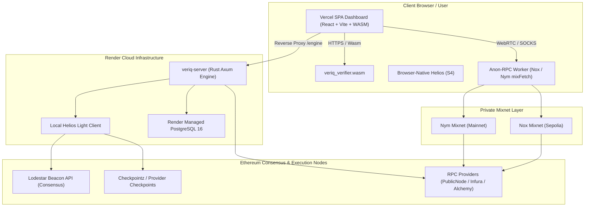

# VeriQ Production Deployment Guide

This guide describes how to deploy the entire VeriQ system live to production:
- **Rust Axum Engine & Managed PostgreSQL**: Render
- **React Frontend Dashboard**: Vercel
- **TypeScript SDK**: npm package (`veriq-client`)
- **Ethereum State Verification**: Sepolia & Mainnet via Helios Consensus
- **Private RPC Transport**: Nox (Sepolia) and Nym Mixnet (Mainnet)

---

## 1. Architecture Overview



---

## 2. Backend Deployment on Render

### Step A: Connect Repository via Render Blueprint
1. Go to the [Render Dashboard](https://dashboard.render.com).
2. Click **New** > **Blueprint**.
3. Connect your repository: `https://github.com/Saikat-Bera04/veriq`.
4. Render detects [`render.yaml`](file:///Applications/Development/veriq/render.yaml) automatically.

### Step B: Fill Required Environment Variables
Render will prompt for configuration secrets defined in `render.yaml`:

| Variable | Recommended Production Value | Description |
|---|---|---|
| `VERIQ_ENV` | `production` | Enforces production fail-closed security. |
| `VERIQ_ROOT_SOURCE` | `helios` | Local Helios consensus light client. |
| `VERIQ_NETWORK` | `sepolia` (or `mainnet`) | Network for the engine instance. |
| `HELIOS_CONSENSUS_RPC` | `https://lodestar-sepolia.chainsafe.io` | Uncapped Beacon API for consensus syncing. |
| `VERIQ_PROVIDERS` | `publicnode=https://ethereum-sepolia-rpc.publicnode.com,alchemy=https://eth-sepolia.g.alchemy.com/v2/YOUR_KEY` | Comma-separated execution RPC providers. |
| `VERIQ_ALLOWED_ORIGINS` | `https://your-domain.vercel.app` | Allowed CORS origins (no wildcards allowed in production). |
| `DATABASE_URL` | *(Auto-populated by Render managed Postgres)* | PostgreSQL connection string. |

### Step C: Deploy & Healthcheck
1. Click **Apply**. Render will:
   - Provision `veriq-postgres` (PostgreSQL 16 with SSD disk).
   - Build Docker container [`docker/Dockerfile.engine`](file:///Applications/Development/veriq/docker/Dockerfile.engine).
   - Start the engine on `0.0.0.0:$PORT`.
2. Verify live deployment:
   ```bash
   curl -s https://<your-render-subdomain>.onrender.com/health | jq .
   ```
   Expected response:
   ```json
   {
     "status": "ok",
     "ok": true,
     "chainId": 11155111,
     "rootSource": "local-light-client",
     "devMode": false,
     "lightClient": {
       "synced": true,
       "finalizedNumber": 7412900
     }
   }
   ```

---

## 3. Database Migrations (PostgreSQL)

The Prisma schema is located at `backend/database/prisma/schema.prisma`.

To apply migrations to your production database from a secure CI runner or local environment:
```bash
# Set production DATABASE_URL
export DATABASE_URL="postgresql://veriq:<password>@<render-host>/proofroute?sslmode=require"

# Run Prisma migration safely
pnpm --filter veriq-server prisma migrate deploy
```

---

## 4. Frontend Deployment on Vercel

### Step A: Import Project in Vercel
1. Go to [Vercel Dashboard](https://vercel.com) > **Add New** > **Project**.
2. Select `Saikat-Bera04/veriq`.
3. Root Directory: `./` (or leave default root).
4. Build Command: `pnpm --filter veriq-client build && pnpm --filter veriq-dashboard build`.
5. Output Directory: `frontend/dashboard/dist`.

### Step B: Configure Environment Variables on Vercel
In Vercel **Project Settings > Environment Variables**:

| Variable | Value | Purpose |
|---|---|---|
| `VITE_ENGINE_URL` | `/engine` | Uses Vercel edge rewrite proxy to bypass CORS. |
| `VITE_CHAIN` | `sepolia` | Default target chain. |
| `VITE_ANON` | `on` | Enables Anon-RPC worker (Nox on Sepolia, Nym on Mainnet). |
| `VITE_BROWSER_LIGHT_CLIENT` | `on` | Runs in-tab Helios light client (S4). |
| `VITE_BROWSER_VERIFIER` | `on` | Runs client-side WASM proof verifier (S5). |
| `VITE_HELIOS_CONSENSUS_RPC` | `https://lodestar-sepolia.chainsafe.io` | Beacon RPC for browser Helios. |

### Step C: Update Proxy Destination in `vercel.json`
Update [`vercel.json`](file:///Applications/Development/veriq/vercel.json) with your live Render backend URL:
```json
{
  "source": "/engine/:path*",
  "destination": "https://<your-render-engine-subdomain>.onrender.com/:path*"
}
```

---

## 5. TypeScript SDK Release (npm)

To publish `@veriq/sdk` or `veriq-client` to npm:

```bash
cd frontend/sdk

# 1. Clean build TypeScript and bundle WASM
pnpm build

# 2. Run test suite
pnpm test

# 3. Authenticate with npm
npm login

# 4. Publish package with provenance
npm publish --access public
```

---

## 6. End-to-End Live Verification

Once deployed, run the automated browser smoke test against your production URL:

```bash
# Direct + Attack Lab verification
pnpm --filter veriq-dashboard smoke -- --base https://<your-app>.vercel.app --no-attacks

# Full Anon-RPC Mixnet verification
pnpm --filter veriq-dashboard smoke -- --base https://<your-app>.vercel.app --anon
```

What the test validates:
1. Landing page loads and footer confirms **"Helios synced"**.
2. `/app/light-client` reports active finalized block and header consensus.
3. `/app/delegation-guard` successfully detects EIP-7702 delegation bytecode.
4. Header badge transitions to **Anon-RPC: ready (nox)**.
5. All reads receive cryptographically verifiable **Trust Receipts**.
