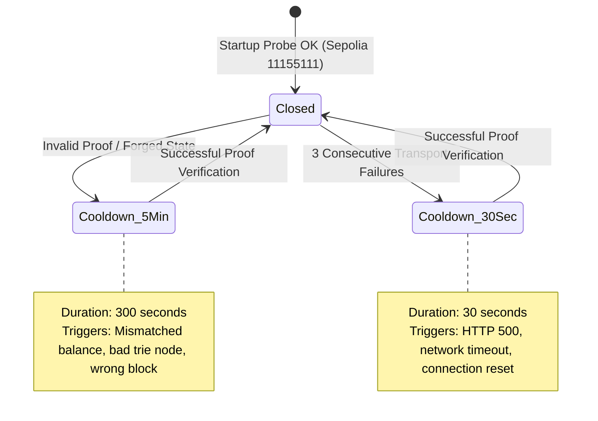
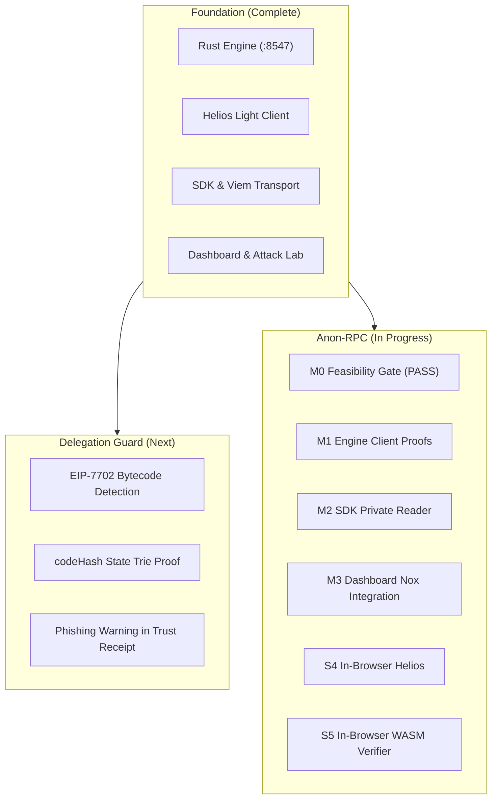

# Veriq — Master Project Plan & Complete Architecture Specification

> **The Definitive Blueprint for Trust-Minimized, Anonymous Ethereum Reads & Account Security**  
> *Version: 1.0.0 · Updated: November 2026 · Target Networks: Ethereum Sepolia & Mainnet*

---

## 1. Executive Summary & Vision

### 1.1 The Core Problem
Ethereum decentralized applications (dApps), hot-wallets, institutional indexers, and off-chain signers rely almost universally on third-party JSON-RPC providers (Alchemy, Infura, QuickNode, PublicNode) using standard methods:
- `eth_getBalance`
- `eth_getStorageAt`
- `eth_getCode`
- `eth_getTransactionCount`

This standard architecture suffers from **three critical vulnerabilities**:
1. **Blind Trust in Centralized State:** Clients accept whatever JSON is returned without mathematical verification. A hijacked RPC (BGP routing compromise, DNS spoofing, malicious or misconfigured provider) can fabricate account balances or contract states.
2. **Metadata & Surveillance Exposure:** Querying RPC providers directly reveals user IP addresses, location metadata, and correlated Ethereum account addresses to infrastructure operators.
3. **Delegation Phishing & Exploits (EIP-7702):** Attackers trick users into signing authorization tuples that install contract bytecode on Externally Owned Accounts (EOAs), draining funds without changing native balances.

### 1.2 The Veriq Solution
Veriq resolves these challenges by introducing a **local cryptographic verification gateway** (`127.0.0.1:8547`) that operates under a zero-trust model:
> **"Read Ethereum state from untrusted RPC providers — and prove every answer."**

```
                     ┌──────────────────────────────────────────────┐
                     │               Ethereum Network               │
                     │  Consensus Layer        Execution Providers  │
                     │  (Nimbus Beacon API)    (Alchemy, PublicNode)│
                     └──────┬─────────────────────────┬─────────────┘
                            │ Finality updates        │ eth_getProof
                            ▼                         ▼
                   ┌─────────────────────────────────────────────────┐
                   │                  Veriq Engine                   │
                   │                 (127.0.0.1:8547)                │
                   │                                                 │
                   │  ┌──────────────────┐    ┌───────────────────┐  │
                   │  │   Helios Light   │    │  Merkle-Patricia  │  │
                   │  │      Client      │    │     Verifier      │  │
                   │  └────────┬─────────┘    └─────────▲─────────┘  │
                   │           │ Finalized              │ Checks     │
                   │           │ state root             │ proof      │
                   │           └───────────► ◄──────────┘            │
                   │                         │                       │
                   │                 Emits verified value            │
                   │                 + Trust Receipt                 │
                   └─────────────────────────┬───────────────────────┘
                                             │
                                             ▼
                             dApp / Wallet / Viem / Wagmi
```

---

## 2. System Architecture & Module Map

### 2.1 Workspace Structure
Veriq is organized as a unified, polyglot monorepo:

```text
veriq/
├── backend/                       # Rust engine & workspace crates
│   ├── Cargo.toml                 # Cargo workspace definition & dependency lock
│   ├── config/                    # Pinned chain and checkpoint configs
│   │   ├── checkpoint.toml        # Pinned Helios weak-subjectivity beacon checkpoint
│   │   └── sepolia.toml           # Sepolia network parameters & bind address
│   ├── crates/                    # 7 specialized workspace crates
│   │   ├── core/                  # Shared data models (Policy, Receipt, ErrorCode, Account)
│   │   ├── verifier/              # Merkle-Patricia trie proof verification logic
│   │   ├── verifier-wasm/         # Dependency-free WebAssembly verifier ABI for browser/edge
│   │   ├── light-client/          # Helios light client integration, root cache, fixtures
│   │   ├── router/                # Provider startup capability probe & circuit breaker
│   │   ├── server/                # HTTP & JSON-RPC daemon (127.0.0.1:8547), receipt store
│   │   └── malicious-rpc/         # Demo attacker JSON-RPC proxy (127.0.0.1:9545)
│   ├── database/                  # Prisma ORM 7 PostgreSQL schema & migrations
│   └── tests/integration/         # Integration test suite running against mock providers
│
├── frontend/                      # TypeScript packages & UI applications
│   ├── sdk/                       # 'veriq-client' library (NPM package)
│   │   ├── src/                   # Client, Viem custom transport, Zod schemas, React hooks
│   │   ├── bin/veriq.ts           # CLI binary (`veriq read-balance ...`)
│   │   └── examples/              # Usage examples (Viem, React wallet)
│   └── dashboard/                 # Vite + React + Tailwind web application
│       ├── src/components/landing # Public landing page showcase
│       └── src/dashboard/pages/   # Overview, Feed, Attack Lab, Providers, Light Client, Policy
│
├── smart-contract/                # Foundry smart contract project
│   ├── src/DemoStorage.sol        # On-chain test fixture (slot 0 counter, mapping base slot 1)
│   ├── script/Deploy.s.sol        # Deployment script for Sepolia
│   └── DEPLOYED.md                # Record of live deployed contract on Sepolia
│
├── spikes/                        # Research and feasibility prototypes
│   └── anon-rpc/                  # Browser-based verification spike using Nox & WebAssembly
│
├── scripts/                       # Orchestration & verification scripts
│   ├── demo.sh                    # Launches Attacker + Engine + Dashboard locally
│   ├── attack-check.sh            # Automated verification of all 6 attacker modes
│   ├── e2e.sh                     # Live Sepolia end-to-end proof test
│   └── check-services.sh          # Diagnostics script for API keys & beacon checkpoints
│
├── docker/                        # Containerization configs (Engine, Attacker, Dashboard)
├── fixtures/                      # Real Sepolia EIP-1186 Merkle proof JSON fixtures
└── docs/                          # Project specifications, QA records, and build plans
```

---

## 3. Core Verification Mechanics

### 3.1 Merkle-Patricia Trie Proofs (EIP-1186)
For every read, Veriq requests an `eth_getProof` pinned to a finalized block hash (`{ "blockHash": "0x..." }`, EIP-1898).

1. **Account Proof Traversal:**
   - Account key: $\text{Nibbles}(\text{keccak256}(\text{address}))$.
   - Veriq walks the proof nodes from the trusted state root down to the leaf node.
   - Decodes RLP trie account:
     $$\text{TrieAccount} = \{ \text{nonce}, \text{balance}, \text{storageRoot}, \text{codeHash} \}$$
   - Asserts $\text{claimed} == \text{proven}$. Any mismatch results in `INVALID_PROOF (-32010)`.

2. **Storage Proof Traversal:**
   - Storage slot key: $\text{Nibbles}(\text{keccak256}(\text{slot}_{32}))$.
   - Root: The account's verified `storageRoot`.
   - Traverses nodes to extract RLP-encoded slot value.

3. **Exclusion (Non-Membership) Proofs:**
   - Veriq never accepts "0" or empty values without proof.
   - Traversal must end at a divergent Leaf or a null child pointer in a Branch node, mathematically proving the address or slot is uninitialized.

4. **Cryptographic Bounds:**
   - `MAX_PROOF_NODES = 64`
   - `MAX_NODE_BYTES = 1024`
   - `MAX_RESPONSE_BYTES = 2 \text{ MiB}`

---

## 4. Multi-Provider Router & Circuit Breaker

The engine manages upstream execution providers via [`veriq-router`](file:///Applications/Development/veriq/backend/crates/router):



### Invariants:
- **Maximum Provider Attempts:** 3 providers attempted sequentially per read within a single overall request deadline (`timeoutMs`).
- **Fail-Closed:** If all providers fail, returns `ALL_PROVIDERS_FAILED (-32016)`. A forged value is **never** returned.

---

## 5. Trust Receipts & Persistence

Every response from Veriq includes a cryptographic **Trust Receipt**:

```json
{
  "identity": {
    "requestId": "018e...-abc-000001",
    "method": "veriq_readBalance",
    "requestBinding": "0x39a1...",
    "resultBinding": "0x8f12..."
  },
  "block": {
    "number": 12076786,
    "hash": "0x04fc...0688",
    "stateRoot": "0x88c4...92e0",
    "finalized": true
  },
  "verification": {
    "status": "verified",
    "rootSource": "helios",
    "verifierLocation": "engine",
    "mechanisms": ["merkle-patricia-account"],
    "bootstrap": {
      "source": "helios",
      "checkpoint": "0x5e6d...1155a",
      "checkpointSource": "beaconcha.in"
    }
  },
  "privacy": {
    "transport": "direct",
    "status": "clear"
  },
  "routing": {
    "providerLabel": "alchemy",
    "attempts": [
      { "provider": "attacker", "status": "invalid-proof", "durationMs": 42 },
      { "provider": "alchemy", "status": "ok", "durationMs": 88 }
    ]
  }
}
```

### Persistence Policy:
- **Best-Effort Audit Trail:** Storage failures never block verified reads.
- **PostgreSQL:** Retains newest 5,000 receipts (Prisma managed).
- **In-Memory Fallback:** Retains newest 500 receipts when `DATABASE_URL` is omitted.

---

## 6. Project Roadmap & Major Workstreams



---

## 7. Part B: Delegation Guard (EIP-7702 Protection)

### 7.1 Threat Model
Under EIP-7702, an EOA can delegate its execution code to a smart contract address by setting its code to the 23-byte designator:
```text
0xef0100 || target_contract_address (20 bytes)
```
Attackers trick victims into signing off-chain authorization tuples, allowing drainer contracts to execute arbitrary transactions on behalf of the EOA while the victim sees no change in account balance.

### 7.2 Implementation Plan
1. **State Trie Code Verification:**
   - Extend `eth_getProof` handling to verify `codeHash` in the account leaf.
   - For any non-empty code hash ($\neq \text{KECCAK\_EMPTY}$), trigger an authenticated `eth_getCode` check.
2. **Delegation Header Parser:**
   - Inspect the first 3 bytes for prefix `0xef0100`.
   - Extract the 20-byte target contract address.
3. **Receipt Warnings & UI Indicators:**
   - Inject `DELEGATED_ACCOUNT` warning into the Trust Receipt.
   - Display a high-visibility amber security alert in the dashboard and wallet UI detailing the delegate target.

---

## 8. Part C: Anon-RPC Master Build Plan

### Tier 1 — Core Private Reads
* **M0 Feasibility Probes (DONE):**
  - M0.0 Test harness PASS.
  - M0.1 Beacon API: Switched to Lodestar with Let's Encrypt certificates.
  - M0.2 `eth_getProof` via Nox: Bounded fallback across `{blockHash}`, tag, and number.
  - M0.3 Gzip via Nox: Verified transparent browser decompression.
  - M0.4 WebAssembly Verifier: Verified in 4.8 ms; 198 KiB binary.
* **M1 Engine Client Proof Verification:**
  - `veriq_getRoot`: Publishes pinned finalized root.
  - `veriq_verifyProof`: Verifies proofs fetched by client over Nox; returns Trust Receipt with `privacy.transport = "anon-rpc"`.
* **M2 SDK Private Reader (`veriq-client`):**
  - `createPrivateReader()` API supporting fallback retries and moving root refresh.
* **M3 Dashboard Private Integration:**
  - Singleton Nox worker initialized on page load.
  - Accessible `AnonStatus` UI indicator with "Direct Mode" toggle.
* **M4 Cloud Hosting:**
  - Vercel dashboard static assets + Render engine deployment.

### Tier 2 — Extended Capabilities
* **S1:** Attack Lab over Nox across all 6 attack modes.
* **S2:** Anonymized provider capability probing via `worker.fetch`.
* **S3:** SDK & Viem transport private-by-default flag.
* **S4 (DONE):** Full Helios light client running inside browser WebAssembly over Nox.
* **S5:** Client-side proof verification via `veriq-verifier-wasm` before engine submission.
* **S6:** Mainnet Tor/Nym transport integration.

### Tier 3 — Latency Optimizations
* **L1:** Worker pre-warming on tab navigation.
* **L2:** Periodic keepalive ping (`eth_chainId` every 20s) to keep mixnet circuits open.
* **L3–L4:** Batched multi-slot storage and code proofs in single JSON-RPC queries.
* **L5:** Verified cache at identical finalized roots (0 ms repeat reads).
* **L6:** Hedged requests across 2 independent privacy relays.

---

## 9. Quality Gates & Definition of Done

Every pull request and build must strictly satisfy:

```bash
# Backend Rust Suite
cargo test --manifest-path backend/Cargo.toml --workspace
cargo fmt --manifest-path backend/Cargo.toml --all -- --check
cargo clippy --manifest-path backend/Cargo.toml --workspace --all-targets -- -D warnings

# Frontend & SDK Suite
pnpm -r lint
pnpm -r test
pnpm -r build

# End-to-End Live Check
./scripts/e2e.sh
./scripts/attack-check.sh
```

### Non-Negotiable Invariants:
1. **Zero Secret Leakage:** No URLs, tokens, keys, or client IPs in receipts, logs, or exceptions.
2. **Fail-Closed Privacy:** `privacy: required` fails closed if Nox/Tor is unavailable; never degrades silently.
3. **Receipt Backward Compatibility:** Schema evolutions must remain purely additive.
