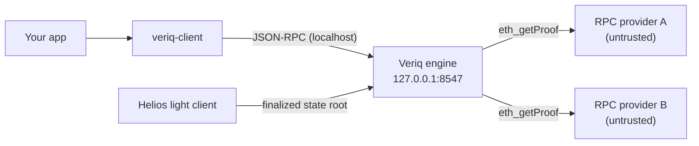

<h1 align="center">Veriq SDK</h1>

<p align="center"><strong>Verified Ethereum reads, with a receipt for every answer.</strong></p>

<p align="center">
  <a href="https://www.npmjs.com/package/veriq-client"></a>
  
  <a href="https://bundlephobia.com/package/veriq-client"></a>
  
</p>

---

`veriq-client` talks to **Veriq**, a local engine on `http://127.0.0.1:8547` that answers Ethereum JSON-RPC on Sepolia. For balance and storage reads, the engine checks a Merkle proof against a **finalized state root from its own Helios light client** and returns the proven value plus a **Trust Receipt**. The SDK never verifies proofs itself: it talks to the engine, validates every receipt's shape with Zod, and makes the result easy to use.

## Why

- **Proofs, not promises.** Every value comes back with the block, state root, provider and proof mechanism that produced it.
- **Fails closed.** When a guarantee can't be met you get a typed error with a one-line hint, never a weaker answer.
- **Drops into what you have.** A viem transport, React hooks and components, and a CLI. About 8 kB min+gzip.



## Quick start

**1. Install**

```bash
pnpm add veriq-client zod
```

**2. Start the engine** (from the Veriq repo)

```bash
export VERIQ_PROVIDERS="a=<sepolia-rpc-1>,b=<sepolia-rpc-2>"
export VERIQ_CONFIG_DIR=backend/config
cargo run --manifest-path backend/Cargo.toml -p veriq-server
```

**3. Read**

```ts
import { createVeriq } from 'veriq-client'

const veriq = createVeriq()
const { value, verified } = await veriq.readBalance({ address: '0xd8dA6BF26964aF9D7eEd9e03E53415D37aA96045' })
console.log(value, verified ? 'verified' : 'NOT verified') // 2000000000000000000n verified
```

## Core API

```ts
const veriq = createVeriq({ url?, policy?, fetch?, timeoutMs?, debug? })
```

| Method | Returns | Notes |
|---|---|---|
| `readBalance({ address, policy? })` | `VerifiedResult<bigint>` | `veriq_readBalance`. Value in wei. |
| `readStorage({ address, slot, policy? })` | `` VerifiedResult<`0x${string}`> `` | `veriq_readStorage`. 32-byte hex. |
| `getReceipt(id)` | `TrustReceipt` | `veriq_getReceipt` |
| `getReceiptRecord(id)` | `ReceiptRecord` | `GET /receipts/:id`, including value, attempts and error |
| `listReceipts(limit?)` | `ReceiptRecord[]` | `GET /receipts?limit=`, newest first |
| `health()` | `EngineHealth` | `GET /health`: light client and providers |
| `providers()` | `ProviderHealth[]` | `veriq_getProviderHealth` |
| `capabilities()` | `Capabilities` | `veriq_getCapabilities` |
| `transport(opts?)` | viem `Transport` | See below |
| `withPolicy(policy)` | `VeriqClient` | New, immutable client |
| `request(method, params?)` | `unknown` | Raw JSON-RPC to the engine (`result` only) |
| `requestWithReceipt(method, params?)` | `{ result, receipt }` | Raw JSON-RPC plus the receipt the engine attaches to standard `eth_*` reads (top-level `veriq` member), Zod-checked; `receipt` is `undefined` for methods without one |

```ts
type VerifiedResult<T> = {
  value: T
  receipt: TrustReceipt   // mirrors backend/crates/core/src/receipt.rs
  verified: boolean       // receipt.verification.status === 'verified'
  attempts: Attempt[]     // every provider tried, rejected ones included
}
```

Before anything is sent, the SDK checks addresses (0x + 40 hex), slots (0x + 1–64 hex) and policy fields, and throws `InvalidRequestError` without making a network call. It does **not** block `latest` + `required`. The engine answers that with `POLICY_UNSATISFIABLE`, so your UI can show the real reason.

The SDK uses only the global `fetch`, so it works in Node 18+, Bun, Deno and browsers. It never logs addresses or URLs, and writes nothing to the console unless `debug: true`.

## Policies & presets

```ts
type Policy = {
  verification: 'required' | 'preferred' | 'disabled'  // VerificationPolicy in policy.rs
  privacy: 'required' | 'preferred' | 'off'
  consistency: 'single' | 'compare'
  blockPolicy: 'finalized' | 'latest'                   // BlockPolicy in policy.rs
  timeoutMs: number                                     // one deadline for all attempts
}
```

| Preset | What it does |
|---|---|
| `verifiedFinalized` (default) | Only proven answers, pinned to finalized blocks, 8 s deadline |
| `verifiedCompare` | Same, and a second provider at the same block (`agree` / `divergent`) |
| `privateVerified` | Verified, private transport only; `PRIVACY_UNAVAILABLE` rather than sending direct |
| `devUnverified` | `verification: 'preferred'` for local dev without a synced light client |

```ts
import { presets } from 'veriq-client'
const strict = veriq.withPolicy(presets.verifiedCompare)
```

## Private reads (Anon-RPC)

`createPrivateReader` fetches each proof through an anonymizing `fetch` (e.g. Nox's
`AnonRpcWorker.fetch`), so providers never see your IP; the engine never contacts them.

```ts
import { createPrivateReader, loadVerifier } from 'veriq-client'
import wasmUrl from 'veriq-client/verifier.wasm?url' // ~205 KB, ~78 KB gzip

const reader = createPrivateReader(veriq, {
  fetch: nox.fetch,
  network: 'nox',
  providers: [{ label: 'ethpandaops', url: 'https://rpc.sepolia.ethpandaops.io' }],
  lightClient,                         // optional: { finalized() } from Helios in the browser
  verifier: () => loadVerifier(wasmUrl), // optional: check proofs in the browser first
})
const { value, receipt } = await reader.readStorage({ address, slot: '0x0' })
receipt.verification.verifierLocation // 'browser'
```

- `lightClient`: its finalized block is the one read; the engine's `veriq_getRoot` must be the
  same block, or the read fails with `RootMismatchError` (`ROOT_MISMATCH`, -32017).
- `verifier`: the engine's own Rust verifier as WebAssembly. A forged proof is rejected before
  the engine is asked. If it fails to load, the engine verifies alone and the receipt says
  `BROWSER_VERIFIER_UNAVAILABLE`.
- Both together: if the engine is unreachable, the read still returns a verified value with a
  receipt made in the browser (`LOCAL_ONLY` warning, `requestId` starting `local-`).

## viem transport

```ts
import { createPublicClient } from 'viem'
import { sepolia } from 'viem/chains'

const transport = veriq.transport({ onReceipt: (r) => console.log('proven at', r.block.number) })
const client = createPublicClient({ chain: sepolia, transport })

const balance = await client.getBalance({ address, blockTag: 'finalized' })
transport.lastReceipt?.verification.status // 'verified'
```

`eth_getBalance` and `eth_getStorageAt` go through the verified path. Every other method is forwarded to the engine unchanged, and unsupported ones come back as `UnsupportedVerificationError`. The engine answers `eth_getTransactionCount` and `eth_getCode` at `"finalized"` with a proof too; their receipt arrives in the response's top-level `veriq` member, and the transport passes it to `lastReceipt` and `onReceipt` like any other. In strict mode (the default when verification is `required`), block tags other than `"finalized"` throw before anything is sent, for all four (`eth_getBalance`, `eth_getStorageAt`, `eth_getTransactionCount`, `eth_getCode`). viem defaults to `latest`, so pass `blockTag: 'finalized'`. viem is an optional peer: the transport imports only its types.

## React components

```tsx
import { VeriqProvider, VerifiedValue, EngineStatus } from 'veriq-client/react'
import 'veriq-client/styles.css'

<VeriqProvider client={veriq}>
  <EngineStatus />
  <VerifiedValue address="0x…" />
</VeriqProvider>
```

| Component / hook | What it is |
|---|---|
| `<ReceiptBadge status \| error size? />` | Status pill with a dot: verified, unverified, unsupported, error |
| `<VerifiedValue address slot? format? />` | Value in the heading style plus badge, a shimmer while loading, name and hint on error; click for the receipt |
| `<ReceiptCard receipt value? attempts? error? />` | The full receipt: block, hashes (copy on click), root source, attempts, raw JSON, download |
| `<EngineStatus health? />` | "● Engine online · 127.0.0.1:8547" / "● Engine offline", plus an amber DEV MODE pill |
| `useVerifiedBalance(address, { policy?, refreshInterval? })` | `{ data, error, isLoading, refresh }` |
| `useVerifiedStorage(address, slot, opts)` · `useVeriqHealth({ refreshInterval = 5000 })` · `useReceipt(id)` | Same shape |

Hooks share a small built-in cache keyed by method and params, revalidate on window focus, and poll when you set `refreshInterval`. No data library is needed.

The styles are plain CSS with `vq-` class names. They read the Veriq dashboard's tokens (`--vq-ink`, `--vq-border`, `--vq-radius-card`, …) and fall back to the same values, so the components look identical inside the dashboard and work in any React app. Motion is CSS only (180 ms fades, a verified-dot pulse, skeleton shimmer) and turns off under `prefers-reduced-motion`.

## CLI

```bash
npx veriq-client read 0xd8dA6BF26964aF9D7eEd9e03E53415D37aA96045
npx veriq-client read 0xCONTRACT --slot 0x0
npx veriq-client health
# flags: --url <engine>  --json  --policy verifiedFinalized|verifiedCompare|devUnverified
```

```text
╭─ Veriq · Trust Receipt ────────────────────────╮
│ ● VERIFIED            0.4213 ETH               │
│ block      #7,412,903  0x9a3f…c21e             │
│ stateRoot  0x51be…07aa                         │
│ root       local light client (Helios)         │
│ provider   alchemy  ·  2 attempts  ·  184 ms   │
│ rejected   infura-bad  INVALID_PROOF           │
╰────────────────────────────────────────────────╯
```

The box uses the dashboard palette as 24-bit colour. Output is plain text when `NO_COLOR` is set or stdout isn't a TTY. Errors print the error name, code and hint, and exit with code 1.

## Errors

Every error extends `VeriqError { code, codeName, hint, data?, receiptId? }`. `String(err)` gives `VeriqError[-32014 POLICY_UNSATISFIABLE]: … — hint`. Use `isVeriqError(e)` or `instanceof`.

| Code | Class | Meaning | Hint |
|---:|---|---|---|
| -32010 | `InvalidProofError` | Every attempted proof failed verification | Add an honest provider or wait for cooldowns |
| -32011 | `RootUnavailableError` | No trusted root yet | The light client hasn't synced a finalized root yet. Wait ~1 min or check /health. |
| -32012 | `UnsupportedVerificationError` | Method or block tag can't be proven | Use blockTag 'finalized' or verification 'preferred' |
| -32013 | `PrivacyUnavailableError` | No healthy private provider; nothing sent | Use privacy 'preferred' or 'off' |
| -32014 | `PolicyUnsatisfiableError` | Contradictory policy | latest + verification=required can't be proven. Use blockPolicy 'finalized'. |
| -32015 | `ProviderTimeoutError` | Deadline ran out (also used for client-side timeouts) | Raise timeoutMs or check provider health |
| -32016 | `AllProvidersFailedError` | Every eligible provider failed | Check `veriq health` for breaker states |
| -32602 | `InvalidRequestError` | Malformed address, slot or policy | Thrown before any network call |
| -1 | `EngineUnreachableError` | Network failure | No Veriq engine at http://127.0.0.1:8547. Start it with: cargo run -p veriq-server |
| -2 | `VeriqSchemaError` | Engine answer doesn't match the schema | `issues` lists paths like `receipt.block.stateRoot: expected 0x-hex, got undefined` |

## Security model & honest limits

- **Finalized only.** A `verified` receipt means the value was proven against a finalized Sepolia state root that the engine's Helios light client authenticated from a pinned checkpoint. `latest` can't be verified and is refused under `required`.
- **The SDK trusts the local engine.** It validates the receipt's shape, not the proof. Run the engine on your own machine. Anything that can impersonate `127.0.0.1:8547` can lie to the SDK.
- **What is verified:** balances, storage slots (account proof plus storage proof, including exclusion proofs for zero values), nonces (the proven account) and contract code (`keccak256(code)` against the proven `codeHash`).
- **Nonce and code have no first-class methods.** There is no `readNonce` / `readCode`: use the viem transport (`getTransactionCount` / `getCode` with `blockTag: 'finalized'`) or `requestWithReceipt('eth_getTransactionCount' | 'eth_getCode', [address, 'finalized'])`. You get the raw hex `result` (not a `bigint`) plus the receipt, and no `verified` / `attempts` shortcut: read `receipt.verification.status` and `receipt.routing.attempts`. These standard methods always run under `verifiedFinalized`: a client or transport policy is not sent with them (the JSON-RPC methods have no policy parameter), so `consistency: 'compare'` and the engine-side `timeoutMs` apply only to `readBalance` / `readStorage` (the client-side timeout still follows the client's policy).
- **What isn't:** every other method is `unsupported` or forwarded unverified, as the policy allows. Agreement between providers is recorded, never treated as proof.
- **Dev mode is unverified.** `rootSource: 'untrusted-rpc'` receipts come from an RPC-supplied root. `<EngineStatus>` shows an amber DEV MODE pill.
- **Privacy:** with `transport: direct`, providers still see the address you query and your IP. Veriq protects integrity, not privacy.

## FAQ

**Does the SDK verify Merkle proofs in the browser?** No. The local engine does. `verifierLocation` in the receipt says where verification happened.

**Why does `client.getBalance()` throw `UnsupportedVerificationError`?** viem sends `latest` by default. Pass `blockTag: 'finalized'`, or create the transport with `{ strict: false }`.

**Can I use it without React or viem?** Yes. The core imports neither. Both are optional peers.

**Where does the receipt shape come from?** `backend/crates/core/src/receipt.rs`. `src/schema.ts` mirrors it field for field, and a test asserts the keys match.

---

Examples live in [`examples/`](examples) and run in the test suite against a mocked engine.
